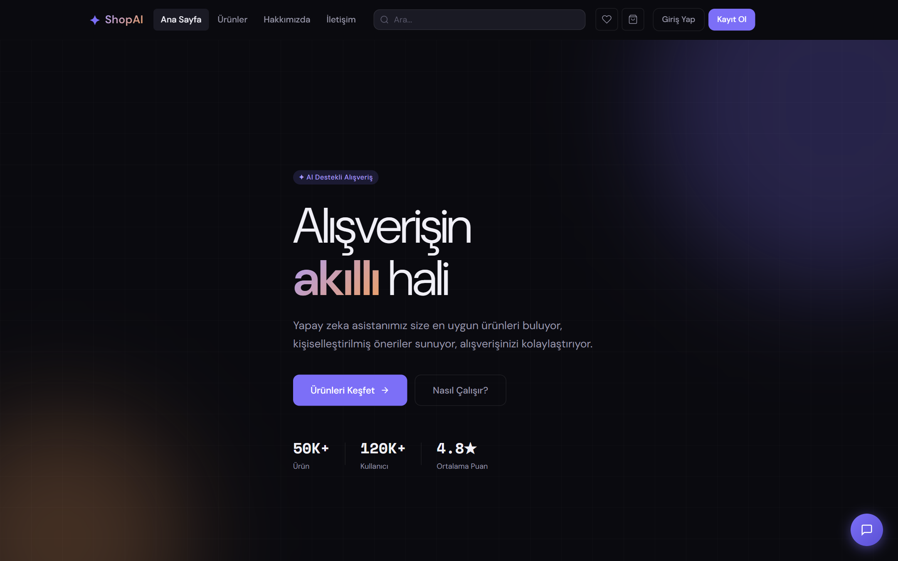
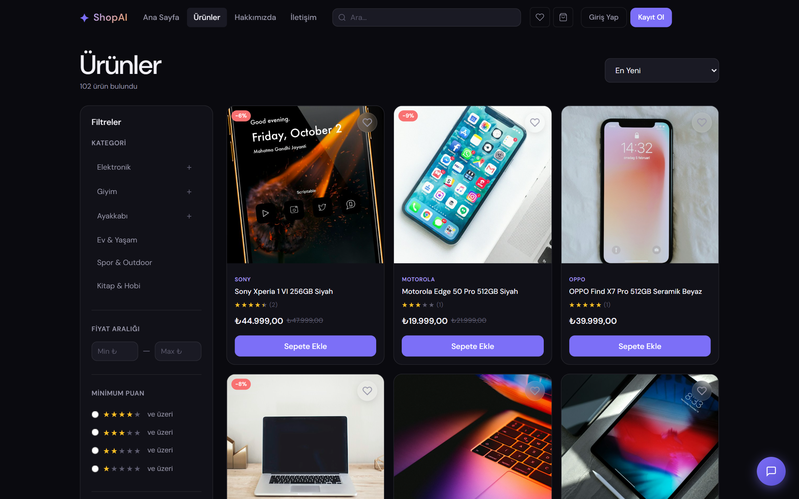
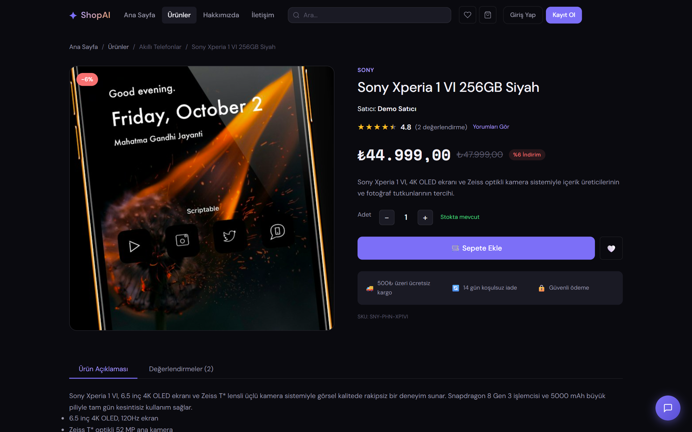
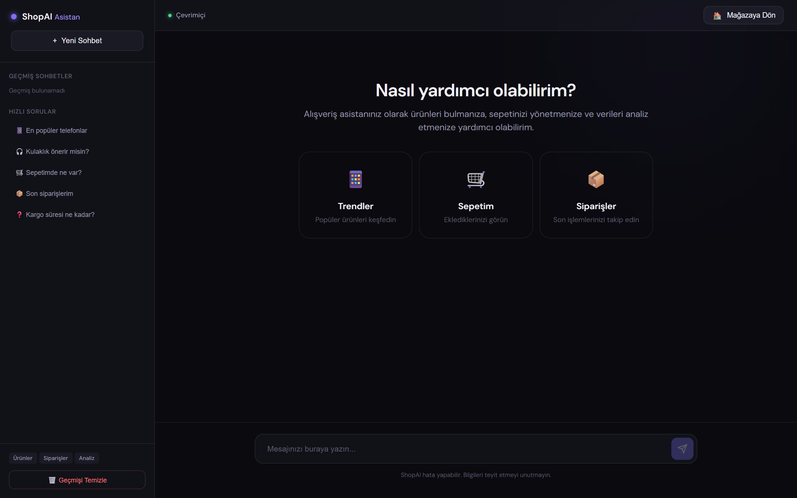
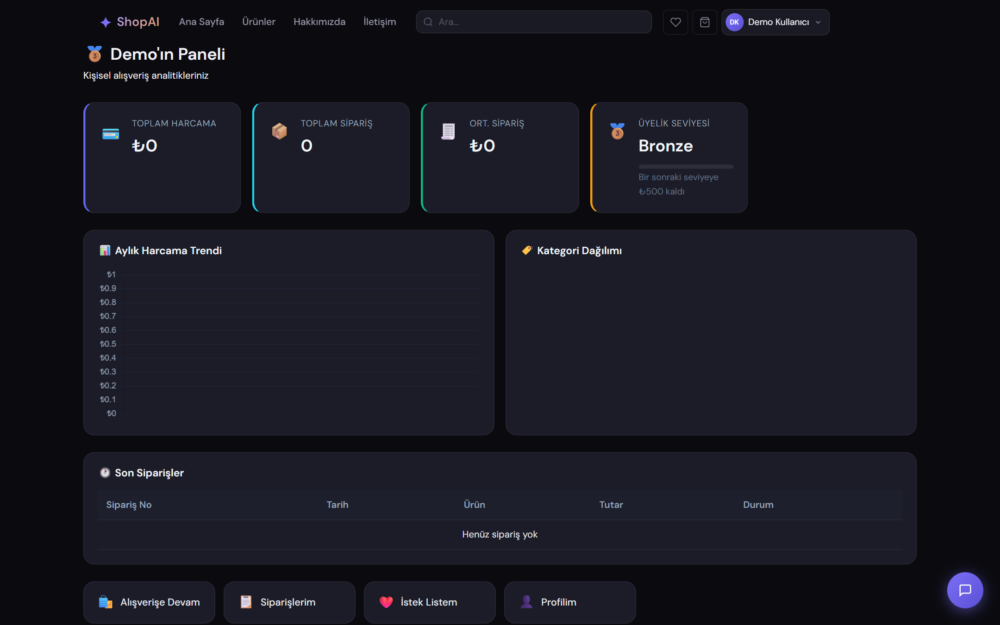
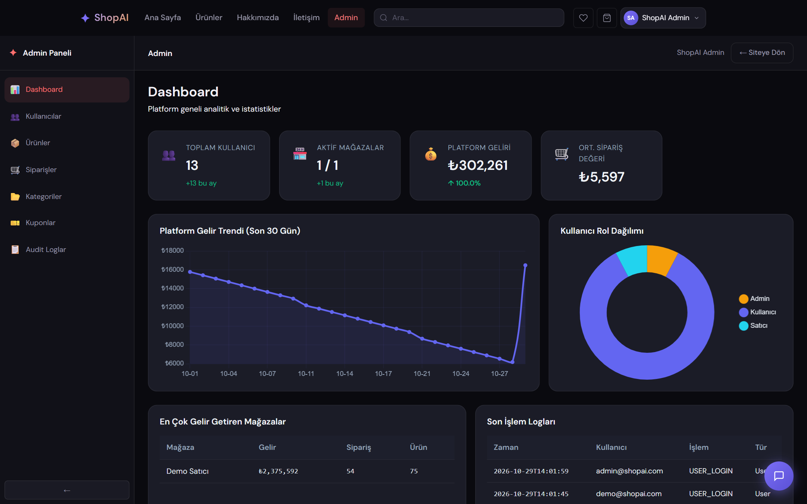
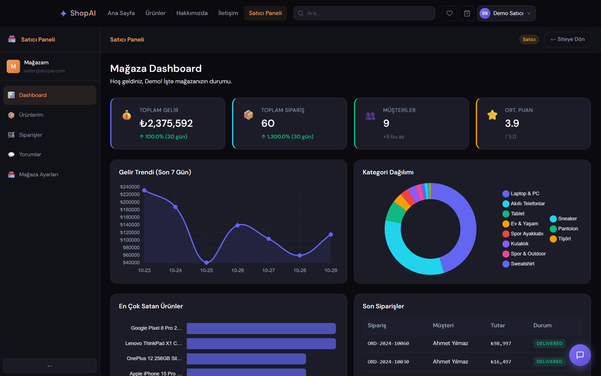
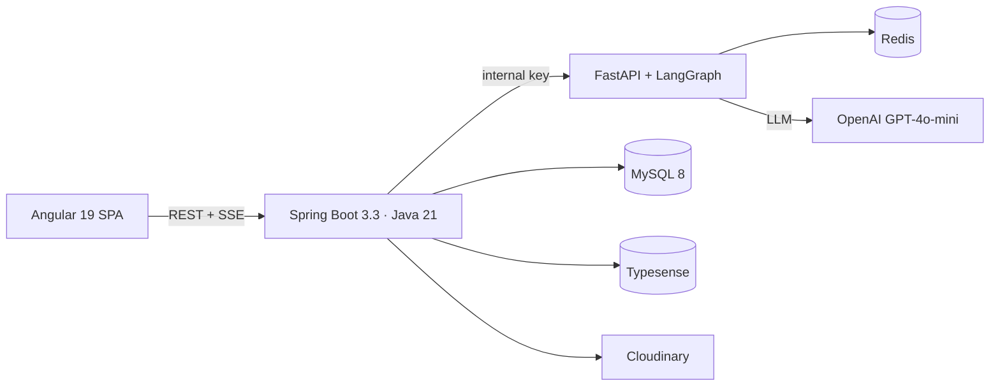

<div align="center">

# ✨ ShopAI

**A multi-vendor e-commerce platform with a built-in, multi-agent AI shopping assistant.**




</div>

## Highlights

| | |
|---|---|
| 🤖 **Agentic assistant** | A LangGraph supervisor routes each message to 10 specialised agents: search, filter, cart, checkout, orders, analytics, FAQ, navigation and more |
| 🛡️ **Human-in-the-loop** | Sensitive actions (checkout, cart changes) need explicit user approval before a tool runs |
| 👥 **3 roles, 3 dashboards** | Customer, Seller and Admin, each with analytics, charts and audit logs |
| 🔍 **Instant search** | Typesense full-text search with typo tolerance |
| 🔐 **Security-hardened** | JWT in HttpOnly cookies, Bucket4j / Redis rate limiting, internal service key between Java and Python, Flyway-versioned schema |

## Screenshots

| Product catalog | Product detail |
|:---:|:---:|
|  |  |
| **AI assistant** | **Customer dashboard** |
|  |  |
| **Admin panel** | **Seller panel** |
|  |  |

## Architecture



| Service | Folder | Role |
|---|---|---|
| Frontend | [`frontend/`](frontend) | Angular 19, standalone components, signals, Chart.js |
| Backend | [`backend/`](backend) | REST API, auth, orders, search indexing (21 controllers, 25 migrations) |
| AI service | [`ai-service/`](ai-service) | Supervisor + agents + tools, rate-limited, structured logs |

## Quick start

```bash
git clone https://github.com/tahircan2/ShopAI.git && cd ShopAI
cp .env.example .env
cp ai-service/.env.example ai-service/.env     # add OPENAI_API_KEY
# create backend/.env (JWT_SECRET, AI_INTERNAL_KEY, TYPESENSE_API_KEY, Cloudinary, SMTP)
docker compose up --build
```

Open **http://localhost**. API docs: http://localhost:8080/swagger-ui.html

Demo accounts are seeded by the Flyway migrations (see `V5__seed_data.sql`); they are for local development only.

## Docs

[Technical report](docs/TECHNICAL_REPORT.md) · [PDF](docs/ShopAI_Technical_Report.pdf) · [Docker guide](docs/DOCKER_GUIDE.md)
